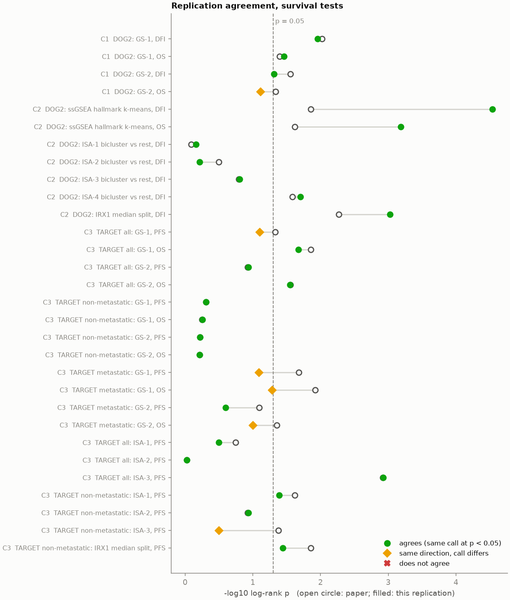
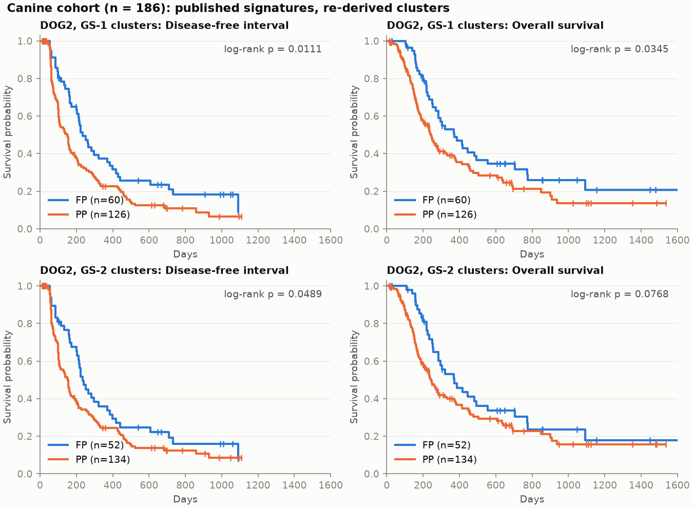
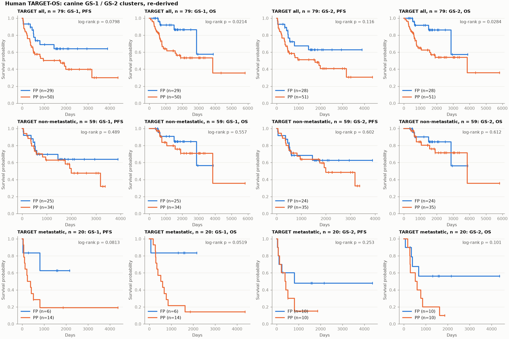
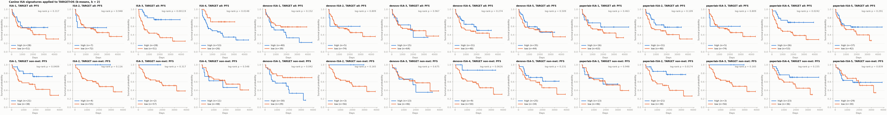
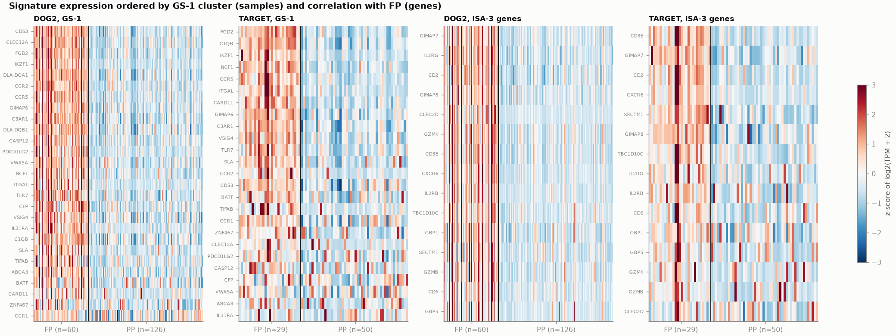
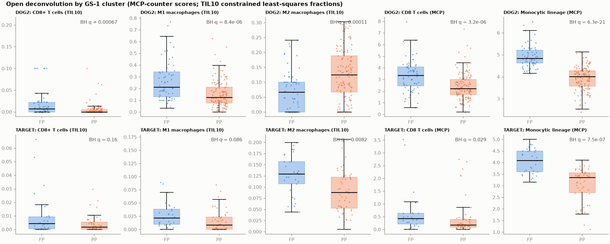

# canine-osteosarcoma-signatures

A claim-by-claim replication of Mannheimer et al., "Transcriptional profiling of canine
osteosarcoma identifies prognostic gene expression signatures with translational value for
humans", *Communications Biology* 6, 856 (2023), doi:10.1038/s42003-023-05208-z, from public data
(GEO GSE238110, NCI GDC TARGET-OS, the paper's supplementary data, and the authors' Zenodo code).



## What the paper claimed

The paper used 186 treatment-naive dogs with appendicular osteosarcoma from the NCI COTC021/022
trial (amputation plus carboplatin, with or without rapamycin; the DOG2 cohort) and 79 pediatric
and young-adult patients from TARGET-OS. Its thesis has four parts:

1. Two previously published canine signatures, GS-1 and GS-2 (Gardner et al. 2019), split DOG2
   into k-means clusters with different disease-free interval (DFI) and overall survival (OS).
2. ssGSEA on Hallmark gene sets, then k-means, then limma-voom DEGs, then ISA biclustering, yields
   de novo canine signatures with prognostic value in dogs.
3. Those canine-derived signatures, applied to TARGET-OS, define clusters with different PFS and
   OS, including in the metastatic-at-diagnosis subgroup (GS-1, GS-2) and the non-metastatic
   subgroup (ISA signatures 1 and 3).
4. Both species share pathway and immune programs: immune Hallmarks are enriched in the
   favorable-prognosis (FP) cluster, and CIBERSORTx gives similar macrophage and CD8+ T cell
   trends in dogs and humans.

## What we found

The full table, with every test, bootstrap CI, BH q-value and the authors' code side by side, is
in [`results/replication_table.md`](results/replication_table.md). Condensed:

| Claim | Test | Paper p | Ours p | HR [95% bootstrap CI] | Agree |
|---|---|---|---|---|---|
| 1 | DOG2 GS-1, DFI (FP 60 / PP 126; paper 58 / 128) | 0.0095 | 0.011 | 1.59 [1.12, 2.28] PP vs FP | yes |
| 1 | DOG2 GS-1, OS | 0.04 | 0.034 | 1.51 [1.05, 2.19] | yes |
| 1 | DOG2 GS-2, DFI (52 / 134, same sizes as paper) | 0.028 | 0.049 | 1.45 [1.02, 2.09] | yes |
| 1 | DOG2 GS-2, OS | 0.046 | 0.077 | 1.43 [1.00, 2.07] | partial |
| 2 | DOG2 ssGSEA k-means clusters, DFI (ours 116 / 70; paper 96 / 90) | 0.014 | 2.9e-05 | 2.03 [1.47, 2.92] | yes |
| 2 | DOG2 ssGSEA k-means clusters, OS | 0.024 | 6.5e-04 | 1.84 [1.28, 2.64] | yes |
| 2 | DOG2 ISA-4 bicluster vs rest, DFI (re-derived from the paper's ssGSEA clusters) | 0.026 | 0.020 | 1.52 [1.05, 2.36] | yes |
| 2 | DOG2 ISA-1, ISA-2, ISA-3 biclusters, DFI | 0.81, 0.32, 0.16 | 0.69, 0.61, 0.16 | | yes (all n.s.) |
| 3 | TARGET all GS-1, PFS / OS | 0.047 / 0.014 | 0.080 / 0.021 | OS 3.27 [1.45, 15.6] | partial / yes |
| 3 | TARGET all GS-2, PFS / OS (clusters identical to the paper's) | 0.12 / 0.028 | 0.12 / 0.028 | OS 3.10 [1.39, 14.6] | yes / yes |
| 3 | TARGET non-metastatic GS-1, GS-2 (PFS and OS) | 0.49 to 0.61 | 0.49 to 0.61 | | yes (all n.s.) |
| 3 | TARGET metastatic GS-1, PFS / OS (ours 6 / 14; paper 5 / 15) | 0.021 / 0.012 | 0.081 / 0.052 | OS 6.01 [0.86, not estimable] | partial / partial |
| 3 | TARGET metastatic GS-2, PFS / OS (ours 10 / 10; paper 4 / 16; ARI 0.13) | 0.081 / 0.044 | 0.25 / 0.10 | | different partition |
| 3 | TARGET all ISA-3 (immune), PFS (clusters identical to the paper's) | 0.0012 | 0.0012 | 3.85 [1.92, 11.7] low vs high | yes |
| 3 | TARGET non-metastatic ISA-1, PFS | 0.024 | 0.041 | 2.70 [1.14, 10.5] | yes |
| 3 | TARGET non-metastatic ISA-3, PFS (ours 57 / 2; paper 33 / 26; ARI 0.02) | 0.042 | 0.32 | not estimable | different partition |
| 4 | Hallmark GSEA, FP-enriched sets at FDR < 0.05 (DOG2 / TARGET all) | 10 / 12 (text; 13 at FDR < 0.05 in the Fig. 4 source data) | 12 / 10 | 10 of the paper's 10 / 10 of 13 shared | yes |
| 4 | DOG2 FP sets also FP-enriched in TARGET | 10 of 10 | 10 of 12 | | yes |
| 4 | CD8 T cells FP > PP (MCP-counter; dog / human BH q) | 2.7e-08 / 0.012 | 3.2e-06 / 0.029 | | yes |
| 4 | M1 macrophages FP > PP (TIL10; dog / human q) | 5.0e-06 / 6.7e-05 | 8.4e-06 / 0.086 | | yes / partial |
| 4 | M2 macrophages FP > PP (TIL10; dog / human q) | 1.5e-06 / 6.7e-05 | PP > FP, 1.1e-04 / FP > PP, 0.0082 | | no / yes |

"yes" means the same call at p < 0.05 (or both not significant); "partial" means the same
direction but one side crosses 0.05; "no" means the opposite direction; "different partition"
means our clusters overlap the paper's with ARI < 0.5, so the two p-values test different
groupings. HRs compare the poor-prognosis (or low-signature) group with the reference, from a
Cox model with Efron ties; CIs are percentile bootstrap over 1000 patient resamples, and a bound
that falls on resamples where one group has no events is reported as not estimable (in the
metastatic GS-1 OS test, 363 of 1000 resamples leave the FP group with no deaths).

Claim by claim:

- **Claim 1 replicates for GS-1 and is borderline for GS-2.** Our GS-1 clusters agree with the
  paper's on 184 of 186 dogs (ARI 0.96) and give the same answer. GS-2 clusters have the paper's
  exact sizes and ARI 0.96, yet the two dogs that swap clusters are enough to push OS from 0.046 to
  0.077. Re-testing the paper's own labels reproduces its printed p-values (23 of 24 comparisons across
  the paper match at printed precision). After BH correction
  across all 30 survival tests in the table, none of the four claim-1 p-values stays below 0.05
  (q = 0.066 to 0.15).
- **Claim 2 replicates in its prognostic part, and the ISA step reproduces when it is given the
  paper's clusters.** Hallmark ssGSEA clusters separate DFI and OS in dogs, more strongly in our
  run than in the paper, but our two clusters overlap the paper's only partly (ARI 0.55). Run on
  the paper's published ssGSEA clusters, our limma-voom plus ISA pipeline gives 190 DEGs (paper:
  259) and recovers all four published ISA signatures (28 of 39, 19 of 29, 17 of 19 and 13 of 15
  genes) plus a fifth myeloid bicluster; the ISA-4-like bicluster is again the only one with a DFI
  difference (p = 0.020). Run on our own ssGSEA clusters, the DEG list (94 genes) has no immune
  genes and ISA returns osteoclast, muscle, cartilage and stromal biclusters instead.
- **Claim 3 reproduces for the full TARGET cohort when the paper's published signatures are
  used, but only ISA-3 holds up under the sensitivity checks, and it fails in the metastatic
  subgroup.** GS-2 and ISA-3 give cluster assignments identical to the paper's and the same
  p-values; against an expression-matched random-signature null only ISA-3 stands out
  (empirical p = 0.017), and non-metastatic ISA-1 (p = 0.041) loses significance with one-to-one
  orthologs (0.11). GS-1 moves one
  patient and PFS goes from 0.047 to 0.080. In the 20 metastatic patients, our GS-1 clusters move
  one patient and lose significance; our GS-2 clusters are a different partition (ARI 0.13). The
  non-metastatic ISA-3 result depends on k-means landing on a balanced split; ours isolates two
  patients.
  The leakage-safe version of this claim, signatures derived from dogs alone and frozen before
  TARGET was opened, is weaker: 4 of 40 tests reach p < 0.05, from 3 distinct signatures, led
  by our dog-only re-derivation of the immune ISA-3 signature (PFS 0.024, OS 0.012). With
  one-to-one orthologs only, its PFS result goes to 0.084, hits drop to 3 of 40, and the
  clean-transfer evidence for the immune signature rests on OS alone (0.016).
- **Claim 4 replicates for pathways and CD8 T cells, and partly for macrophages.** The immune
  Hallmark sets enriched in FP are almost the same sets the paper lists in both species; GS-1 FP
  vs PP DEGs shared across DOG2, TARGET and TARGET non-metastatic number 85 (paper: 84) and are
  enriched for PD-1 signalling, TCR signalling, CD28 co-stimulation and interferon-gamma
  signalling in Reactome. MCP-counter CD8 T cell and monocyte-lineage scores are higher in FP in
  both species (with TIL10, human CD8 does not reach significance, q = 0.16). M2 macrophages go the paper's way in humans and the opposite way in dogs with TIL10;
  the paper's strongest cell-type result (M0 macrophages higher in PP) cannot be tested with an
  open method because none of them models an M0 state.

### Frozen canine signatures in TARGET (leakage-safe test of claim 3)

The published ISA signatures were chosen by the paper's authors after both cohorts existed. A
cleaner test of claim 3 is to derive signatures from dogs only, freeze them, and only then open
TARGET. We did that for 10 signatures: 5 from our own ssGSEA clusters (`denovo`) and 5 from the
paper's published ssGSEA clusters (`paperlab`). Their gene lists are hashed in
`results/frozen_signatures.json`, and `scripts/04_transfer_target.py` refuses to run if the hash
changes. Each was applied to TARGET all and non-metastatic, for PFS and OS: 40 tests.

**4 of the 40 reach p < 0.05, from 3 distinct signatures.** A naive count would compare 4 with
the 2 expected by chance, but the 40 tests are not independent: PFS and OS share each
partition, and denovo-ISA-2 and paperlab-ISA-3 produce the same partition, so this is 3
signatures out of 10 with at least one hit, not 4 independent successes. With one-to-one
orthologs only, paperlab-ISA-4 PFS goes from 0.024 to 0.084, hits drop to 3 of 40, and the
clean-transfer evidence for the immune signature rests on OS alone (p = 0.016). The
strongest is paperlab-ISA-4, our dog-only re-derivation of the immune ISA-3 signature (13 of its
15 genes), in TARGET all: PFS p = 0.024 and OS p = 0.012, low-immune worse (HR 2.50 [1.16, 7.82]
for PFS). The other two are paperlab-ISA-2 (stromal, close to ISA-1) for non-metastatic PFS
(p = 0.017) and denovo-ISA-1 (osteoclast genes) for non-metastatic PFS (p = 0.042). None of the
40 would survive a correction for 40 tests. Full table:
[`results/replication_table.md`](results/replication_table.md#frozen-canine-signatures-in-target-leakage-safe-test-of-claim-3).

| Signature (genes) | TARGET all PFS | TARGET all OS | Non-met PFS | Non-met OS |
|---|---|---|---|---|
| denovo-ISA-1 (7; closest ISA-1, 0 shared) | 0.15 | 0.73 | 0.042 * | 0.68 |
| denovo-ISA-2 (7; closest ISA-2, 7 shared) | 0.81 | 0.68 | 0.16 | 0.33 |
| denovo-ISA-3 (6; closest ISA-4, 4 shared) | 0.97 | 0.96 | 0.68 | 0.94 |
| denovo-ISA-4 (8; closest ISA-1, 7 shared) | 0.27 | 0.58 | 0.063 | 0.12 |
| denovo-ISA-5 (5; closest ISA-1, 0 shared) | 0.51 | 0.5 | 0.23 | 0.26 |
| paperlab-ISA-1 (28; closest ISA-4, 28 shared) | 0.46 | 0.47 | 0.95 | 0.68 |
| paperlab-ISA-2 (20; closest ISA-1, 19 shared) | 0.11 | 0.32 | 0.017 * | 0.091 |
| paperlab-ISA-3 (17; closest ISA-2, 17 shared) | 0.81 | 0.68 | 0.16 | 0.33 |
| paperlab-ISA-4 (13; closest ISA-3, 13 shared) | 0.024 * | 0.012 * | 0.16 | 0.3 |
| paperlab-ISA-5 (14; closest ISA-1, 0 shared) | 0.29 | 0.26 | 0.84 | 0.38 |

`*` p < 0.05 (log-rank, k-means k = 2 on the frozen genes).

### Sensitivity checks the paper did not run

All numbers below are in `results/sensitivity_*.csv` (`python scripts/06_sensitivity.py`).

- **Whole-pipeline bootstrap.** Resampling patients and re-clustering from scratch 200 times,
  the share of resamples with log-rank p < 0.05 is 0.63 for DOG2 GS-1 DFI, 0.46 for GS-1 OS,
  0.57 and 0.39 for GS-2 DFI and OS, 0.43 and 0.67 for TARGET GS-1 PFS and OS, 0.32 and 0.63 for
  TARGET GS-2, 0.59 for TARGET ISA-3 PFS, and 0.32 to 0.48 for every subgroup result. None of the
  survival splits recurs in more than 70% of resamples.
- **Random-signature null in TARGET.** Random gene sets of the same size, each gene drawn from
  the same mean-expression bin as the signature gene it replaces and clustered the same way
  (k-means, k = 2, 10 starts), give p < 0.05 in 3% to 18% of 1000 draws, so a survival split
  from an arbitrary gene set is not rare in this cohort. Against that null, ISA-3 (PFS,
  empirical p = 0.017) stands out; GS-2 OS (0.058), ISA-4 (0.071), GS-1 OS (0.095), the
  metastatic GS-1 results (0.098 and 0.10) and non-metastatic ISA-1 (0.12) do not clear 0.05.
- **Choice of k.** The silhouette picks k = 2 for every published-signature clustering, but its
  margin is small in TARGET (for example 0.168 vs 0.113 for GS-2), and the log-rank p moves
  across 0.05 between k = 2 and k = 3 to 6 in most cohorts (DOG2 GS-1 DFI: 0.011, 0.058, 0.041,
  0.11, 0.001). In non-metastatic TARGET, ISA-3 has its highest silhouette (0.60) for a split that
  isolates 2 patients at every k.
- **Seed stability.** Single-start k-means agrees with itself across 50 seeds for the canine
  clusterings (mean ARI 0.89 to 0.91) and TARGET GS-1/GS-2 (0.90 to 0.96), but not for the
  metastatic subgroup (0.37 to 0.49) or the ISA signatures in TARGET (0.12 to 0.29). The
  paper's TARGET ISA-3 split is the 10-start solution; single starts often find another.
- **Multiple testing.** BH across the 30 survival tests in the table leaves 4 below q = 0.05:
  the two DOG2 ssGSEA tests, DOG2 IRX1, and TARGET ISA-3 PFS. Nothing from claim 1 survives.
- **One-to-one orthologs only.** Re-running every TARGET transfer with only Ensembl one-to-one
  orthologs (dropping one-to-many and same-symbol mappings; 23 of 25 GS-1 genes, 12 of 15 ISA-3
  genes kept) changes the call at p < 0.05 in 4 of 70 tests: TARGET GS-1 PFS becomes significant
  (0.080 to 0.027), non-metastatic ISA-1 PFS does not (0.041 to 0.11), non-metastatic ISA-4 PFS
  becomes significant (0.55 to 0.0094, a different partition), and paperlab-ISA-4 PFS in TARGET
  all loses significance (0.024 to 0.084; its OS stays at 0.016). ISA-3 in TARGET all stays
  significant (PFS 0.0012 to 0.030, OS 0.0042 to 0.015). The canine ssGSEA clusters barely move
  (ARI 0.96 between mappings). Table: `results/sensitivity_one2one_orthologs.csv`
  (`python scripts/09_one2one_orthologs.py`).
- **Leakage.** The canine-derived signatures are hashed in `results/frozen_signatures.json`
  before any human file is opened; `scripts/04_transfer_target.py` stops if the hash does not
  match, and `scripts/06_sensitivity.py` checks that the derivation script never names a human
  file. FP/PP and high/low are named by mean signature score, never by outcome.

### Figures

| | |
|---|---|
|  |  |
|  |  |
|  | |

## Method

Every step is a committed script; `scripts/run_all.sh` runs them in order.

1. **Data preparation** (`scripts/01_prepare.py`). DOG2: raw counts for the 186 dogs in the
   paper's source data, edgeR-style `filterByExpr` (min.count 10, min.prop 0.5, large.n 5; 13,419
   of 37,952 probes kept), TPM from CanFam4 exon lengths, duplicate symbols averaged, quantile
   normalization. TARGET: GDC STAR-Counts TPM for protein-coding genes, 79 cases, quantile
   normalization. Canine symbols map to human symbols through Ensembl 116 orthologs
   (14,583 one-to-one, 751 one-to-many resolved by rule, 1,693 by identical symbol).
2. **Published signatures** (`scripts/02_published_signatures.py`). log2(x + 2), per-gene z-score,
   k-means over k = 2..6 with silhouette choice (k = 2 won in every cohort), FP = cluster with the
   higher mean signature score. Each test is run three ways: the paper's own labels re-tested,
   our re-derivation, and the authors' `km_clust.py` (patched only so it runs) on the same input.
3. **De novo canine signatures** (`scripts/03_denovo_dog.py`, canine data only). The authors'
   TMM/ComBat log-CPM script, ssGSEA on 50 Hallmarks, k-means, limma-voom with trial as batch,
   then 25 seeded ISA runs (CRAN `isa2`) with the authors' thresholds and a 75% consensus rule.
   The resulting gene lists are written to `results/frozen_signatures.json` with a sha256.
4. **Transfer to TARGET** (`scripts/04_transfer_target.py`). Checks the sha256 first, then applies
   the published ISA signatures and our frozen ones to TARGET all and non-metastatic.
5. **Pathways and immune cells** (`scripts/05_immune_pathways.py`). Hallmark GSEA (gseapy,
   signal-to-noise, 1000 phenotype permutations), limma-voom DEGs at the paper's threshold,
   Reactome over-representation, MCP-counter and TIL10 constrained least squares.
6. **Sensitivity** (`scripts/06_sensitivity.py`, `scripts/09_one2one_orthologs.py`) and **tables and figures**
   (`scripts/08_replication_table.py`, `scripts/07_figures.py`).

Seeds are fixed (k-means `random_state=0`, `n_init=10`; bootstrap seed 0; R `set.seed(0)`).

## Data

| Source | Use | Access |
|---|---|---|
| GEO GSE238110 | DOG2 raw counts, trial per dog | public |
| Supplementary Data 1 and 2 of the paper | per-patient DFI/OS/PFS, the paper's cluster labels, GS-1/GS-2 lists | CC BY 4.0 |
| Zenodo 10.5281/zenodo.8125077 | authors' code | CC BY 4.0 |
| NCI GDC TARGET-OS | STAR-Counts for 88 tumours (79 used), clinical records for cross-checks | open access |
| Ensembl 116, NCBI CanFam4, MSigDB 7.5.1, quanTIseq TIL10, MCP-counter | orthologs, gene lengths, gene sets, deconvolution references | public |

GEO GSE238110 has no clinical fields. The outcomes come from the paper's Supplementary Data 1,
which lists DFI, OS and censoring for all 186 dogs; TARGET OS events and metastatic status agree
with the GDC records for 79 of 79 patients. Sources, licenses and citations are in
[`docs/DATA.md`](docs/DATA.md). Nothing large is committed; `scripts/fetch_data.py` downloads it
and checks md5 (Zenodo, GDC) and sha256 (`data/checksums.sha256`).

## Deviations

All of them, with reasons, are in [`docs/DEVIATIONS.md`](docs/DEVIATIONS.md). The ones that matter
most:

- IPA is proprietary: Reactome over-representation and gseapy GSEA instead.
- CIBERSORTx needs registration: MCP-counter and a TIL10 constrained least-squares fit instead,
  neither of which has an M0 macrophage state.
- Bioconductor `eisa` no longer installs: CRAN `isa2`, which `eisa` wraps.
- The authors' `km_clust.py` cannot run as published (`np.argmax(...)[0]` raises), and their
  `TMM_Normalization.R` discards the TMM factors it computes; we patch the first minimally and run
  the second as written.
- ISA input uses the Methods' DEG threshold (adj.P < 0.05 and fold change > 3), because the
  limma script's adj.P-only cutoff returns about 7,500 genes with 186 dogs.
- TARGET expression is the current GDC release, not the one the authors downloaded.

## Reproduce

Python 3.12 and R 4.4 (edgeR, limma, sva, isa2). About 0.7 GB of downloads and intermediates; set
`COS_DATA_DIR` and `COS_WORK_DIR` to put them on another disk.

```bash
git clone https://github.com/Rishabd2/canine-osteosarcoma-signatures && cd canine-osteosarcoma-signatures
python -m venv .venv && . .venv/bin/activate
pip install -r requirements.txt
Rscript R/install.R                      # after installing R, edgeR, limma, sva (see the file header)
export RSCRIPT=$(which Rscript)
python scripts/fetch_data.py             # GEO, GDC, Zenodo, supplementary data, references
bash scripts/run_all.sh                  # about 30 minutes on an Apple M2 laptop after downloads
python -m pytest -q
```

Outputs: `results/replication_table.md` (and `.csv`), `results/claims_*.csv`,
`results/sensitivity_*.csv`, `results/frozen_signatures.json`, and `figures/*.png`.

## What I learned and why I tested it

I picked this paper because it asks the question I care about most in comparative oncology:
can dogs stand in for children with osteosarcoma well enough that a finding in dogs changes what
we try in human trials? The paper and the work it cites describe canine osteosarcoma as common,
aggressive and metastatic in the same way the human disease is, and this cohort is unusually clean. Every dog was treatment-naive at
biopsy, every dog had the same surgery and the same chemotherapy backbone inside a prospective
trial, and follow-up followed a harmonized schedule. TARGET patients, as the paper notes, likely
received a wider range of therapies and less uniform follow-up. If a transcriptional signal is real, the dog cohort is where it
should be easiest to see, and the human cohort is where it is hardest to fool yourself.

Each claim tests a different link in that argument. Claim 1 asks whether a known signature holds
up in a new, larger canine cohort, which is the minimum for any biomarker. Claim 2 asks whether
the pipeline can find signal without being told where to look. Claim 3 is the translational
claim and the one a trial designer would act on. Claim 4 asks whether the biology underneath is
shared or whether the survival splits are coincidences that happen to line up.

What surprised me was how much of the paper is reproducible exactly, and how much of what is not
comes down to a few patients. Given the same public data, GS-2 and ISA-3 in TARGET give cluster
assignments identical to the paper's, patient for patient, and the same p-values. The ISA step,
fed the paper's own clusters, recovers the published signatures nearly gene for gene. The
pathway result, immune Hallmarks enriched in the favorable cluster in both species, came back
almost set for set. That is a better outcome than I expected from a pipeline with a deprecated R
package, an unassigned TMM call and a Python script that cannot run as published.

What did not hold, or held only barely: GS-2 in dogs and GS-1 PFS in TARGET sit right at
p = 0.05 and move across it when one or two patients change cluster. None of the claim-1 tests
survives a multiple-testing correction across the table. The metastatic-subgroup result rests on
20 patients and a 5 versus 15 split; moving one patient takes it from p = 0.02 to p = 0.08, and
the paper's GS-2 split there is not one k-means finds again. The non-metastatic ISA-3 result
depends on k-means finding a balanced split rather than isolating two outliers. Our own ssGSEA
clusters were more prognostic than the paper's but led to a completely different DEG list and
different biclusters, so the de novo signatures are a property of one particular clustering, not
of the data. The check that changed my reading most was the random-signature null: in TARGET, expression-matched random gene
sets of the same size split survival at p < 0.05 in 3% to 18% of draws, so a p of 0.02 to 0.05
from one signature is weak evidence on its own; only ISA-3 clearly beats that baseline.
The frozen-signature test points the same way. When I derived signatures from dogs alone and
locked them before opening TARGET, 3 of 10 signatures had at least one human test under 0.05
(4 of 40 correlated tests), and the clearest was again the immune signature. That hit is
fragile: with one-to-one orthologs only, its PFS result rises to 0.084 and the evidence rests on
OS alone (0.016). That is weak transfer at best, and the gene lists involved depended on which
canine clustering they came from.
The M2 macrophage direction flipped between species with an open deconvolution
method, and M0, the paper's strongest cell-type result, cannot be checked without CIBERSORTx.

For using dog data to inform human trials, my read is this. The shared immune program is the
part that replicates most strongly as biology: an immune-hot transcriptional state, with higher
MCP-counter CD8 T cell and monocytic-lineage scores and interferon and allograft-rejection
signalling, marks the favorable cluster in both species, in a dog cohort with standardized
treatment. Its link to outcome is weaker than its biology: nominal in dogs (GS-1 DFI p = 0.011,
q = 0.066 after BH) and, in humans, clear only for ISA-3. That makes it a candidate prognostic
marker under chemotherapy; whether it predicts immunotherapy benefit is untested here. The specific gene lists and
the k-means cut points are fragile, and their p-values are near the threshold in cohorts of 79
and 186. If the immune axis were used to stratify a trial, I would want it as a continuous,
pre-specified score with a fixed threshold, validated in an independent human cohort, rather
than a k-means cluster label carried over from these data.

## Repo layout

```
scripts/        fetch_data.py, 01_prepare.py ... 09_one2one_orthologs.py, run_all.sh
src/cos_sig/    orthologs, normalize, scoring (z-score, ssGSEA), clustering, survival,
                deconv, enrichment, signatures, authors (runs km_clust.py), pipeline, rrun
R/              authors_tmm_combat.R, limma_voom.R, isa_runs.R (adapted from the authors), install.R
tests/          ortholog mapping, signature scoring, survival splits, GSEA sign
data/           paper_reported_values.csv, checksums.sha256 (raw/ and work/ are gitignored)
results/        replication_table.md, claims_*.csv, sensitivity_*.csv, cluster assignments,
                frozen_signatures.json, deconvolution and GSEA tables
figures/        Kaplan-Meier curves, heatmaps, deconvolution, replication summary
docs/           DEVIATIONS.md, DATA.md
```

## Limitations

- Outcomes for both species come from the paper's own supplementary data, so this replication
  checks the analysis, not the clinical annotation. TARGET OS events and metastatic status were
  cross-checked against GDC; canine outcomes could not be checked independently.
- Canine TPM uses exon-union lengths rather than RSEM effective lengths, and TARGET uses a newer
  GDC processing; either can move patients near a k-means boundary.
- The open deconvolution methods are not CIBERSORTx: TIL10 lacks M0 macrophages, TIL10 was fit
  to canine data through human orthologs (108 of 170 signature genes mapped), and MCP-counter
  gives scores, not proportions.
- Reactome over-representation answers a different question than IPA's curated pathways, so the
  IPA pathway lists are compared only in spirit.
- Our ssGSEA uses GenePattern's weighting exponent but not its exact implementation; that may be
  part of why our ssGSEA clusters differ from the paper's.
- The ISA consensus rule (gene Jaccard of at least 0.5, more than 75% of runs) is our reading of
  "bi-clusters that appeared in more than 75% of the trials".
- With 20 metastatic and 59 non-metastatic TARGET patients, every human subgroup test is
  underpowered; bootstrap CIs on those HRs are wide.

## Citation and license

Original article: Mannheimer JD, Tawa G, Gerhold D, Braisted J, Sayers CM, McEachron TA,
Meltzer P, Mazcko C, Beck JA, LeBlanc AK. Transcriptional profiling of canine osteosarcoma
identifies prognostic gene expression signatures with translational value for humans.
*Commun Biol* 6, 856 (2023). https://doi.org/10.1038/s42003-023-05208-z. Authors' code:
https://doi.org/10.5281/zenodo.8125077. To cite this replication, use [`CITATION.cff`](CITATION.cff).

Code in this repository is MIT licensed ([`LICENSE`](LICENSE)). The three R scripts adapted from
the authors' Zenodo record keep its CC BY 4.0 terms; see [`NOTICE`](NOTICE).
